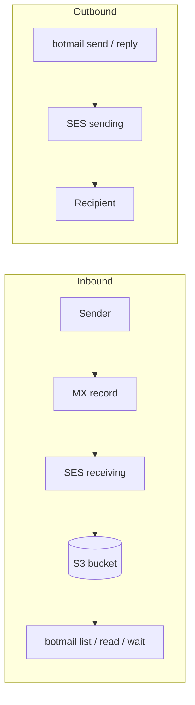

<p align="center">
  
</p>

<p align="center">
  <a href="https://pypi.org/project/botmail-cli/"></a>
  <a href="https://github.com/emaillme/botmail/blob/main/LICENSE"></a>
</p>

<p align="center"><strong>Give your AI agent its own email address on Amazon SES and S3, plus a CLI mail client.</strong></p>

> **Made by emaillme**  
> Don't want to run mail infrastructure? [emaillme.com](https://emaillme.com) gives your agent an inbox that reads the thread and attachments, looks up the answer, and replies in plain words. Team options: [emaillme Pro](https://emaillme.com/pro).

# botmail

**botmail** is the open-source CLI behind that setup: inbound mail is received by [Amazon SES](https://aws.amazon.com/ses/) and stored in [S3](https://aws.amazon.com/s3/) as raw MIME; outbound mail goes out through SES. It uses **boto3** only (no AWS CLI).

You use it when your agent needs a real inbox for sign-ups, verification codes, magic links, password resets, and replies. Commands expose the mailbox with stable **`--json`** output for automation.

The PyPI distribution is **`botmail-cli`** (the name `botmail` is taken on PyPI). The command on your PATH is still `botmail`.

## How it works



ASCII overview:

```
Sender -> MX -> SES (inbound) -> S3 -> botmail
botmail -> SES (outbound) -> recipient
```

## Install

From PyPI:

```bash
pipx install botmail-cli
# or
pip install botmail-cli
```

From Git (alternative):

```bash
pipx install git+https://github.com/emaillme/botmail.git
# or
pip install --user git+https://github.com/emaillme/botmail.git
```

Development install:

```bash
git clone https://github.com/emaillme/botmail.git
cd botmail
pip install -e ".[dev]"
```

## Quickstart

1. Deploy AWS resources (see [AWS setup](#aws-setup)) and note bucket, prefix, and domain.
2. Configure credentials (role recommended, or optional keys in an env file).
3. List mail:

```bash
export BOTMAIL_DOMAIN=example.com
export BOTMAIL_PREFIX=example.com/
export BOTMAIL_BUCKET=my-botmail-bucket
export AWS_REGION=us-east-1

botmail --json list --limit 10
```

Or use `~/.config/botmail/agent.env`:

```bash
# Optional static keys; omit to use IAM role / instance profile / AWS_PROFILE
# AWS_ACCESS_KEY_ID=...
# AWS_SECRET_ACCESS_KEY=...
# AWS_SESSION_TOKEN=...
BOTMAIL_DOMAIN=example.com
BOTMAIL_PREFIX=example.com/
BOTMAIL_BUCKET=my-botmail-bucket
BOTMAIL_REGION=us-east-1
# BOTMAIL_ROLE_ARN=arn:aws:iam::123456789012:role/botmail-agent
```

If exactly one file exists in `~/.config/botmail/*.env`, it is picked automatically; otherwise set `BOTMAIL_ENV` or pass `--env`.

Global flags: `--domain`, `--prefix`, `--bucket`, `--region`, `--profile`, `--role-arn`, `--external-id`, `--role-session-name`, `--json`.

## Commands

### `list`

```bash
botmail list
botmail list --to agent@example.com --since 2h --limit 20 --unread
botmail --json list --limit 3
```

`--json` example:

```json
[
  {
    "id": "msg-1",
    "date": "2024-06-01T12:00:00+00:00",
    "from": "noreply@example.com",
    "to": "agent@example.com",
    "subject": "Your code",
    "unread": true
  }
]
```

### `read`

```bash
botmail read MESSAGE_ID
botmail read MESSAGE_ID --raw
botmail --json read MESSAGE_ID
```

`--json` example (truncated):

```json
{
  "id": "msg-1",
  "headers": {
    "from": "noreply@example.com",
    "to": "agent@example.com",
    "subject": "Your code",
    "date": "2024-06-01T12:00:00+00:00",
    "message_id": "<id@example.com>"
  },
  "body": "Your verification code is 123456",
  "attachments": [],
  "authentication_results": ""
}
```

### `wait`

Polls S3 until a message matches `--to` (and optional `--subject-contains`).

```bash
botmail wait --to agent@example.com --subject-contains Verify --timeout 300
botmail --json wait --to agent@example.com --timeout 60
```

`--json` example:

```json
{
  "id": "inbound-abc123"
}
```

### `links`

```bash
botmail links MESSAGE_ID
botmail --json links MESSAGE_ID
```

`--json` example:

```json
{
  "links": [
    "https://example.com/verify?token=abc"
  ]
}
```

### `save-attachments`

```bash
botmail save-attachments MESSAGE_ID ./downloads
botmail --json save-attachments MESSAGE_ID ./downloads
```

`--json` example:

```json
{
  "paths": [
    "/path/downloads/report.pdf"
  ]
}
```

### `send`

`--from` must be `*@BOTMAIL_DOMAIN`.

```bash
botmail send --from agent@example.com --to user@example.org \
  --subject "Hello" --body "Plain text"

botmail send --from agent@example.com --to user@example.org \
  --subject "Hello" --body-file ./msg.txt --html-file ./msg.html --attach ./file.pdf

botmail --json send --from agent@example.com --to user@example.org \
  --subject "Hello" --body "Hi"
```

`--json` example:

```json
{
  "message_id": "0100018a00000000-00000000-0000-0000-0000-000000000000-000000"
}
```

### `reply`

```bash
botmail reply MESSAGE_ID --body "Thanks"
botmail --json reply MESSAGE_ID --body "Thanks"
```

`--json` example:

```json
{
  "message_id": "0100018a00000000-...",
  "in_reply_to": "msg-1"
}
```

## AWS setup

### 1. Pick a region

Use an SES region that supports **email receiving** (for example `us-east-1`, `eu-west-1`). The bucket and receipt rule must be in the **same region** as SES receiving.

See [Amazon SES endpoints](https://docs.aws.amazon.com/general/latest/gr/ses.html).

### 2. Verify your domain (outbound + identity)

In SES, verify the domain you will send from and receive on. Enable **DKIM** (Easy DKIM). This is **not** created by the included CloudFormation template.

Console: SES -> Verified identities -> Create identity (domain).

CLI:

```bash
aws sesv2 create-email-identity --email-identity example.com
```

Add the DKIM CNAME records SES provides to your DNS.

### 3. MX record for inbound mail

Publish an MX record pointing at the SES inbound endpoint for your region. Example for `example.com` in `us-east-1`:

```
10 inbound-smtp.us-east-1.amazonaws.com
```

See [Receiving email with Amazon SES](https://docs.aws.amazon.com/ses/latest/dg/receiving-email.html).

### 4. Deploy infrastructure

Template: [`infra/botmail.yaml`](https://github.com/emaillme/botmail/blob/main/infra/botmail.yaml).

Example (account `123456789012`):

```bash
aws cloudformation deploy \
  --stack-name botmail-inbox \
  --template-file infra/botmail.yaml \
  --parameter-overrides \
    DomainName=example.com \
    BucketName=my-botmail-bucket-unique \
    MailboxPrefix=example.com/ \
    CreateReceiptRuleSet=true \
    RuleSetName=botmail-inbound
```

### 5. Activate the receipt rule set

Only **one** receipt rule set is active per region. If you created a new set, activate it:

```bash
aws ses set-active-receipt-rule-set --rule-set-name botmail-inbound
```

Check the active set:

```bash
aws ses describe-active-receipt-rule-set
```

If `CreateReceiptRuleSet=false`, the rule is added to an **existing** `RuleSetName` you already manage.

### 6. IAM for agents

**Recommended:** attach the stack output `BotmailPolicyArn` to a role your agent runs as, or use the optional `BotmailRoleArn` from the template. Pass the role to botmail:

```bash
export BOTMAIL_ROLE_ARN=arn:aws:iam::123456789012:role/botmail-agent
```

**Fallback:** IAM user access keys in the env file (discouraged for production).

botmail never prints credentials.

### 7. Leave the SES sandbox

New SES accounts are in sandbox mode (limited recipients). Request production access in the SES console when you are ready to send to arbitrary addresses.

### Costs (rough)

- **SES**: per-message pricing for send and receive; see [SES pricing](https://aws.amazon.com/ses/pricing/).
- **S3**: storage and requests for stored MIME; see [S3 pricing](https://aws.amazon.com/s3/pricing/).
- **Data transfer**: standard AWS data transfer charges may apply.

### Security notes

- Block public access on the inbox bucket (the template does this).
- Scope IAM to the inbox prefix and `ses:FromAddress` for your domain.
- Treat inbound MIME as untrusted (phishing, malware). Scan attachments before opening.
- Rotate keys if used; prefer instance/task roles and `AssumeRole`.

## Development

```bash
pip install -e ".[dev]"
pytest -q
ruff check src tests
cfn-lint infra/botmail.yaml
```

See [Developer guide](https://github.com/emaillme/botmail/blob/main/docs/developer.md) and [AGENTS.md](https://github.com/emaillme/botmail/blob/main/AGENTS.md).

## Hosted alternative

You can run this project on your own AWS account, or use a hosted inbox if you would rather not operate SES, S3, and DNS yourself. Either way, you stay responsible for what your agent sends and for treating inbound mail as untrusted data.

| | **botmail (self-hosted)** | **[emaillme](https://emaillme.com) (hosted)** |
| --- | --- | --- |
| Who runs mail infrastructure | You, on your AWS account | emaillme |
| How your agent uses mail | Install `botmail-cli`; call `list`, `read`, `wait`, `send`, and other subcommands with `--json` | Use an emaillme inbox that reads the thread and attachments, looks up the answer, and replies in plain words |
| Setup | Domain verification, DKIM, MX, CloudFormation or manual IAM, SES rule set | Sign up at [emaillme.com](https://emaillme.com); see [emaillme Pro](https://emaillme.com/pro) for team-oriented options |
| Transparency | MIT-licensed source in this repository | Managed service; product details on emaillme's site |
| Good fit when | You want open source, direct AWS control, or custom automation | You want an agent inbox without running the AWS stack yourself |

botmail and emaillme address the same practical need (agents need real email). You choose how much of the stack you want to operate.

## License

MIT. See [LICENSE](https://github.com/emaillme/botmail/blob/main/LICENSE).